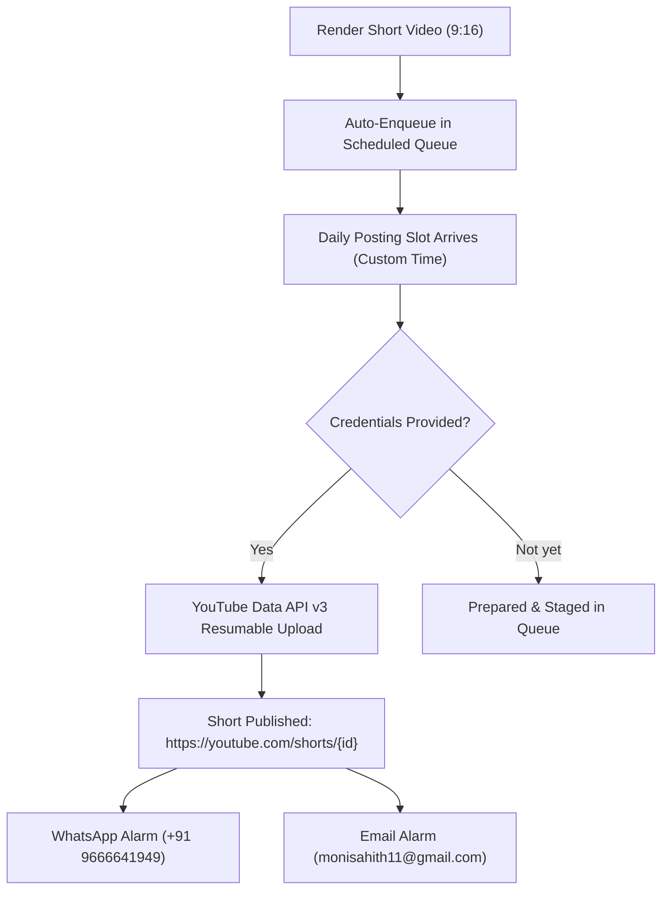

# 🎬 YouTube Automated Daily Upload Setup Guide

The automated background upload architecture is **100% built, tested, and actively waiting for your channel credentials**.

---

## ⚡ Where to Add Your Credentials (Choose Any 1 Option):

### Option A: Directly from the Studio Web UI (Easiest)
1. Open your studio at **[http://localhost:5000](http://localhost:5000)**.
2. Click the **"Daily Auto-Upload"** tab.
3. In the **"YouTube Channel Automated Uploader"** box, paste:
   - **Client ID** (e.g., `xxxx.apps.googleusercontent.com`)
   - **Client Secret** (e.g., `GOCSPX-xxxxxxxxxxxx`)
   - **Refresh Token** (e.g., `1//04xxxxxxxxxxxx`)
   - Select default privacy: **Public**, **Unlisted**, or **Private**.
4. Click **"Save Channel Credentials"** $\rightarrow$ click **"Test Connection"** to verify your channel name!

---

### Option B: In the Config File
Open [cache/youtube_credentials.json](file:///c:/Users/miriy/Desktop/Documents/downloader/cache/youtube_credentials.json) and fill in:
```json
{
  "client_id": "YOUR_CLIENT_ID_HERE.apps.googleusercontent.com",
  "client_secret": "YOUR_CLIENT_SECRET_HERE",
  "refresh_token": "YOUR_REFRESH_TOKEN_HERE",
  "privacy_status": "public"
}
```

---

### Option C: Drop your `client_secret.json`
Simply place your downloaded `client_secret_*.json` file from Google Cloud Console into the root project directory:
`c:\Users\miriy\Desktop\Documents\downloader\`
The system automatically discovers and parses your `client_id` and `client_secret`!

---

## 🚀 How the Automation Works



1. **Daily Scheduler**: Fires at your custom time for each day (configured in the UI).
2. **Resumable Upload**: Uses Google's official resumable chunk upload protocol optimized for vertical shorts.
3. **Automatic SEO & Tags**: Formats titles with `#Shorts`, generates high-converting descriptions, and tags for Category 24 (Entertainment).
4. **Instant Alarms**: Alerts your WhatsApp (`+91 9666641949`) and Email (`monisahith11@gmail.com`) with the live YouTube Short link.
